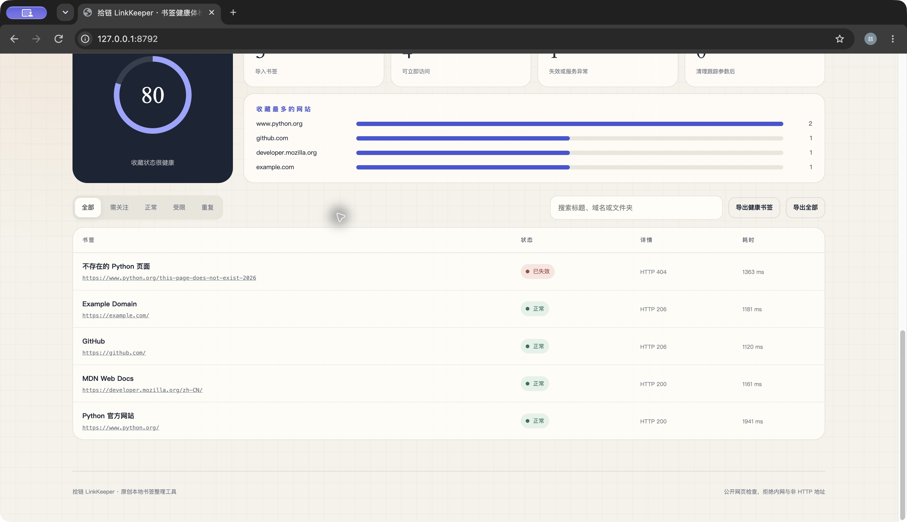

# 拾链 LinkKeeper

一个不需要硬件、无需账号、依赖极少的**浏览器书签健康体检与整理工具**。

浏览器收藏夹会不断积累失效链接、重复文章和带跟踪参数的地址。拾链一次导入就能检查数百个公开网页，并将仍然可访问的书签重新导出为标准浏览器文件。



## 功能

- 导入 Chrome、Edge、Firefox、Safari 等浏览器导出的 HTML 书签
- 保留原收藏夹层级
- 异步并发检查，不限等待一个同步请求
- HTTP 状态语义分类
- HEAD 失败后自动使用 GET 重试
- 跟踪跳转并获取最终地址
- 提取网页标题
- 清理 `utm_*`、`fbclid`、`gclid` 等跟踪参数
- 识别规范化后重复的书签
- 按域名统计收藏集中度
- 按异常、正常、受限、重复筛选
- 导出健康书签或全部书签
- 中文响应式界面，无 CDN 和前端框架

## 立即运行

要求 Python 3.9+。

```bash
cd outputs/linkkeeper
python3 run.py
```

打开：

```text
http://127.0.0.1:8792
```

点击“试用示例”可以体验完整流程。真实浏览器书签文件不会上传到项目仓库，只会发送到本机运行的扫描服务；网页由服务端直接检查，不会保存在磁盘。

## 在线网址与 GitHub 部署

项目包含 GitHub Pages 和 Docker/Render 两套部署配置：

- `web/` 可直接部署为 GitHub Pages。
- `server/` 可通过仓库根目录的 `Dockerfile` 或 `render.yaml` 部署为 HTTPS BFF。
- Pages 上默认启用**本地整理模式**：导入、结构检查、重复检测、参数清理和导出全部可用。
- 配置 `web/config.js` 的 `LINK_KEEPER_API` 后，页面自动启用在线 HTTP 状态深检。

部署后端后修改：

```js
window.LINK_KEEPER_API = "https://你的后端域名";
```

GitHub Pages 不能执行 Python，因此不能单独承载在线 HTTP 状态检查；这是平台能力边界，不是前端故障。

## 工作方式


扫描接口不会暴露完整书签内容给第三方；服务端只向书签指向的网站发送请求。

## 安全设计

- 仅允许公开 HTTP/HTTPS 地址。
- 禁止 localhost、环回、私网、链路本地和保留地址。
- 禁止 URL 内嵌账号密码。
- 默认只允许 80/443 端口。
- 每次重定向都重新执行地址安全检查。
- 请求超时限制为 7 秒，最多读取 64 KiB HTML 用于标题提取。
- 单次最多扫描 300 条书签。

这些措施降低 SSRF 风险，但本地安全工具仍应避免扫描不可信来源提供的大批网址。生产部署应增加出口代理、DNS pinning、登录鉴权和全局限流。

部分 Clash、Surge 等代理使用 `198.18.0.0/15` fake-IP。服务只有在检测到系统 HTTP/HTTPS 代理，且域名的全部解析结果都属于该特殊网段时才允许继续请求；普通私网、环回和保留地址仍会被阻断。

## 测试

```bash
PYTHONPATH=. python3 -m unittest discover -s tests -v
```

测试覆盖嵌套书签解析、URL 规范化、重复识别、私网拦截、重定向追踪、403/404 分类、异步任务和书签导出。

## 目录

```text
linkkeeper/
├── server/
│   ├── bookmarks.py   # 解析与导出
│   ├── checker.py     # 单链接检查
│   ├── jobs.py        # 异步任务与汇总
│   ├── url_tools.py   # 去重和安全策略
│   └── app.py         # HTTP API
├── web/index.html     # 中文控制台
├── tests/
└── docs/简历与面试.md
```

## 简历价值

这个项目不是普通 CRUD，可以讨论并发、异步任务、URL 语义、重定向、错误分类、安全边界和浏览器文件格式兼容性。完整表述见 [docs/简历与面试.md](docs/简历与面试.md)。
